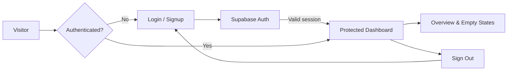

<div align="center">

# 🚀 DevOps Insight AI

### A smarter workspace for repository visibility and CI/CD monitoring

**An evolving SaaS project for teams and agencies that manage software delivery across multiple repositories.**

[](https://react.dev/)
[](https://www.typescriptlang.org/)
[](https://vite.dev/)
[](https://supabase.com/)
[](#project-status)

**[Features](#-features) · [Tech Stack](#-tech-stack) · [Getting Started](#-getting-started) · [Roadmap](#-product-roadmap)**

</div>

---

## ✨ The Vision

Managing multiple GitHub repositories and CI/CD workflows can quickly become difficult, especially for agencies working with several clients. **DevOps Insight AI** aims to bring repository activity, pipeline status, and actionable insights into one clean, centralized workspace.

> **One workspace. Clearer delivery insights. Less context switching.**

## 🧩 Features

### ✅ Built so far

- **Login and signup pages** with responsive, pastel-inspired UI
- **Supabase authentication** using email and password
- **GitHub OAuth sign-in integration** in the authentication flow (requires Supabase/provider configuration)
- **Protected dashboard route** for signed-in users
- **Dashboard overview** with repository, pipeline, alert, and team metric placeholders
- **Account-aware welcome message** and sign-out functionality
- **Client-side form validation** and user feedback messages

> **Note:** Dashboard metrics currently display placeholders (`0`). Repository data, pipeline events, and alerts are **not yet connected to live services**.

### 🔜 Planned capabilities

- Connect and manage GitHub repositories
- Track CI/CD pipeline runs and failure trends
- Surface actionable failure insights with AI assistance
- Configure alerts and notifications
- Support multiple teams, clients, and workspaces
- Add usage analytics and reporting

## 🛠️ Tech Stack

| Layer | Technology | Purpose |
|---|---|---|
| Frontend | React + TypeScript | Component-based, type-safe UI |
| Build tooling | Vite | Fast development and production builds |
| Styling | Tailwind CSS + custom CSS | Responsive layouts and polished UI |
| Navigation | React Router | Client-side routing and protected pages |
| Authentication | Supabase Auth | User signup, login, and sessions |
| Icons | Lucide React | Consistent interface icons |
| Backend *(planned)* | Python + FastAPI | APIs and service integrations |
| Database *(planned)* | PostgreSQL | Application and monitoring data |
| Integrations *(planned)* | GitHub APIs / webhooks | Repository and workflow events |

## 🖥️ Current App Flow



## 📁 Project Structure

```text
DevOps-Insight-AI/
├── frontend/
│   ├── src/
│   │   ├── components/
│   │   │   └── auth/
│   │   │       └── ProtectedRoute.tsx
│   │   ├── lib/
│   │   │   └── supabase.ts
│   │   ├── pages/
│   │   │   ├── LoginPage.tsx
│   │   │   ├── SignupPage.tsx
│   │   │   └── DashboardPage.tsx
│   │   ├── styles/
│   │   │   ├── SignupPage.css
│   │   │   └── DashboardPage.css
│   │   ├── App.tsx
│   │   └── main.tsx
│   └── package.json
├── .gitignore
└── README.md
```

*Structure reflects the current frontend work. Additional services and folders will be introduced as the project grows.*

## ⚡ Getting Started

### Prerequisites

- [Node.js](https://nodejs.org/) and npm
- A [Supabase](https://supabase.com/) project
- Git

### 1. Clone the repository

```bash
git clone https://github.com/Aish-369/DevOps-Insight-AI.git
cd DevOps-Insight-AI/frontend
```

### 2. Install dependencies

```bash
npm install
```

### 3. Configure environment variables

Create `frontend/.env.local`:

```dotenv
VITE_SUPABASE_URL=your_supabase_project_url
VITE_SUPABASE_PUBLISHABLE_KEY=your_supabase_publishable_key
```

The frontend's Supabase client should read these variables. Configure your authentication provider and redirect URLs in the Supabase dashboard if using GitHub OAuth.

> 🔐 **Security:** Never commit `.env.local`, secret keys, or Supabase service-role keys. Frontend variables are exposed in the browser, so use only the publishable/anon key and enforce authorization with appropriate Supabase policies.

### 4. Start the app

```bash
npm run dev
```

Open the local URL printed by Vite (usually `http://localhost:5173`).

### 5. Build for production

```bash
npm run build
```

## 🧭 Product Roadmap

- [x] Initialize React + TypeScript frontend
- [x] Build login and signup UI
- [x] Integrate Supabase email/password authentication
- [x] Add protected dashboard route
- [x] Create responsive dashboard layout
- [ ] Connect GitHub repositories and retrieve real data
- [ ] Build pipeline monitoring and event history
- [ ] Develop FastAPI backend and persistence layer
- [ ] Add AI-assisted pipeline failure insights
- [ ] Introduce alerts, client workspaces, and team permissions
- [ ] Add tests, production deployment, and observability

## 📌 Project Status

**🚧 Active development — frontend foundation stage.**

The authentication flow and initial dashboard UI are in place. Monitoring, AI analysis, and multi-client features describe the **product direction**, not functionality already available today.

## 👩‍💻 About the Developer

Built by **Aishwarya Pawar**, a Computer Science graduate exploring full-stack development, developer tools, and practical SaaS engineering.

- **GitHub:** [@Aish-369](https://github.com/Aish-369)
- **LinkedIn:** [Aishwarya Pawar](https://www.linkedin.com/in/aishwarya-pawar-018166315/)

I’m building this project in public to learn by shipping real features, improving the architecture step by step, and documenting the journey.

---

<div align="center">

**⭐ Follow the project to see DevOps Insight AI evolve!**

*Built with curiosity, consistency, and a focus on real-world engineering.*

</div>
