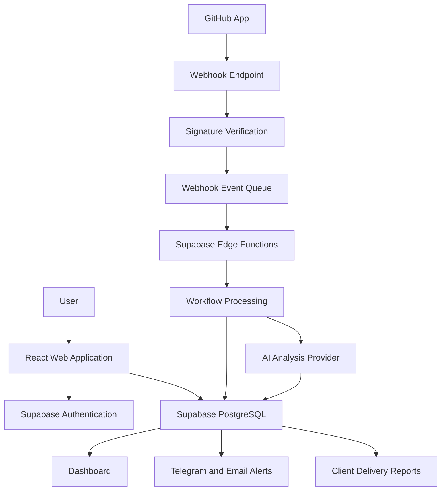

# 🚀 DevOps Insight AI

### Intelligent CI/CD Monitoring and Delivery Insights for Software Agencies

DevOps Insight AI is a SaaS platform in development that aims to help software agencies monitor GitHub repositories, track CI/CD pipeline failures, understand technical issues through AI-powered explanations, and manage software delivery activity from one centralized workspace.

**One workspace. Clear delivery visibility. Smarter decisions.**


---

## 📌 Table of Contents

- [Overview](#-overview)
- [Problem We Solve](#-problem-we-solve)
- [Target Users](#-target-users)
- [Key Features](#-key-features)
- [Current Implementation Status](#-current-implementation-status)
- [Technology Stack](#-technology-stack)
- [System Architecture](#-system-architecture)
- [Project Structure](#-project-structure)
- [Getting Started](#-getting-started)
- [Environment Variables](#-environment-variables)
- [Development Commands](#-development-commands)
- [Security](#-security)
- [Development Roadmap](#-development-roadmap)
- [Project Status](#-project-status)
- [Author](#-author)

---

## 🎯 Overview

Software agencies frequently manage multiple client projects, GitHub repositories, and CI/CD pipelines.

Monitoring these repositories separately makes it difficult to understand pipeline health, identify recurring failures, and communicate delivery progress.

**DevOps Insight AI** aims to simplify this process by bringing repository activity, pipeline monitoring, failure analysis, notifications, and client-wise reporting into one platform.

The initial target market is small software agencies managing approximately 3–30 developers.

## ❗ Problem We Solve

Development teams commonly face:

- Difficulty monitoring multiple GitHub repositories.
- Delayed awareness of failed CI/CD pipelines.
- Time-consuming investigation of pipeline failures.
- Repeated troubleshooting of similar errors.
- Limited visibility into client-wise development activity.
- Manual preparation of weekly delivery reports.

DevOps Insight AI aims to address these challenges through centralized monitoring and actionable insights.

## 👥 Target Users

- Small software development agencies.
- Software development teams.
- Technical project managers.
- Agency owners managing multiple client projects.

## ✨ Key Features

### 1. GitHub Repository Monitoring
- Connect repositories through a GitHub App.
- Monitor repository and workflow activity.
- View repository-level delivery information.

### 2. CI/CD Pipeline Monitoring
- Track GitHub Actions workflow runs.
- Identify failed and successful executions.
- Monitor workflow status and failure trends.

### 3. AI-Powered Failure Analysis
- Explain pipeline failures in simple language.
- Identify likely root causes from available evidence.
- Suggest practical troubleshooting steps.
- Reuse previous analyses for recurring failure patterns where appropriate.

### 4. Smart Notifications
- Failure notifications through Telegram and email.
- Recovery notifications.
- Duplicate notification prevention.
- Configurable notification rules.

### 5. Client Management
- Organize repositories by client.
- View client-wise development activity.
- Maintain a centralized view of client projects.

### 6. Delivery Reports
- Generate weekly delivery summaries.
- Track workflow success and failure trends.
- Provide client-wise development insights.

**Note:** These are planned product capabilities. They should not be considered production-ready until implementation and verification are complete.

## 🛠️ Current Implementation Status

The project currently has a frontend foundation.

### Existing frontend work

- React and TypeScript application.
- Login and signup interfaces.
- Supabase authentication integration.
- Protected application routes.
- Dashboard interface.
- Repository-related screens.
- Teams and activity-related interface work.
- Responsive UI components.

### Not yet production-ready

- GitHub App installation and webhook processing.
- Reliable workflow ingestion and reconciliation.
- AI-powered failure analysis.
- Production notification delivery.
- Organization-level database isolation and automated RLS testing.
- Client reporting pipeline.

Dashboard placeholders must not be interpreted as verified live monitoring data.

## 💻 Technology Stack

| Layer | Technology |
|---|---|
| Frontend | React 19 |
| Programming Language | TypeScript |
| Build Tool | Vite |
| Styling | Tailwind CSS 4, Custom CSS |
| Routing | React Router |
| Icons | Lucide React |
| Authentication | Supabase Auth |
| Database | Supabase PostgreSQL |
| Database Security | PostgreSQL Row Level Security |
| Backend Processing | Supabase Edge Functions |
| GitHub Integration | GitHub App, Webhooks |
| Event Processing | PostgreSQL, pg_cron, pg_net |
| AI Integration | Modular LLM Provider |
| Notifications | Telegram, Email |
| Error Monitoring | Sentry |
| Version Control | Git, GitHub |
| CI/CD | GitHub Actions |

The backend and integration technologies above describe the planned architecture, not completed integrations.

## 🏗️ System Architecture

The intended high-level architecture:



This diagram represents the target architecture. Components will become active as their respective development phases are completed.

## 📁 Project Structure

```text
DevOps-Insight-AI/
│
├── apps/
│   └── web/
│       ├── src/
│       │   ├── components/
│       │   ├── hooks/
│       │   ├── lib/
│       │   ├── pages/
│       │   ├── styles/
│       │   ├── App.tsx
│       │   └── main.tsx
│       │
│       ├── index.html
│       ├── package.json
│       ├── package-lock.json
│       ├── vite.config.ts
│       ├── tsconfig.json
│       ├── tsconfig.app.json
│       ├── tsconfig.node.json
│       ├── eslint.config.js
│       └── .env.example
│
├── supabase/
│   └── migrations/
│
├── .github/
│   └── workflows/
│
├── .gitignore
└── README.md
```

The `src/` and `frontend/` directories at the repository root are temporarily retained during repository consolidation. The new frontend application location is `apps/web/`.

## 🚀 Getting Started

### Prerequisites

Install the following:

- Node.js 22
- npm
- Git
- A Supabase project

### 1. Clone the repository

```bash
git clone https://github.com/Aish-369/DevOps-Insight-AI.git
```

### 2. Navigate to the frontend application

```bash
cd DevOps-Insight-AI/apps/web
```

### 3. Install dependencies

```bash
npm ci
```

### 4. Configure environment variables

Create a local `.env.local` file inside `apps/web/`.

Use `.env.example` as the template.

```env
VITE_SUPABASE_URL=
VITE_SUPABASE_PUBLISHABLE_KEY=
VITE_SENTRY_DSN=
```

Add your own Supabase project configuration locally.

Never commit real credentials or secrets.

### 5. Start the development server

```bash
npm run dev
```

The Vite development server will provide a local URL in the terminal.

## ⚙️ Development Commands

Run these commands from `apps/web/`.

| Command | Purpose |
|---|---|
| `npm run dev` | Start development server |
| `npm run lint` | Run ESLint checks |
| `npm run build` | Run TypeScript checks and production build |
| `npm run preview` | Preview production build |

## 🔐 Security

Security is a core requirement of this project.

- Organization-level data isolation through PostgreSQL RLS.
- Server-side storage of GitHub App credentials.
- Webhook signature verification before event processing.
- No GitHub installation access tokens stored in the database.
- No sensitive tokens stored in browser local storage.
- Validation of external input.
- Protection against untrusted CI logs and repository content.
- Automated authorization and isolation tests before production launch.

## 🗺️ Development Roadmap

| Phase | Development Area | Status |
|---|---|---|
| Phase 0 | repository consolidation and Foundation | In Progress |
| Phase 1 | Database Schema and RLS | Planned |
| Phase 2 | GitHub App and Webhook Integration | Planned |
| Phase 3 | Workflow Processing and Dashboard Data | Planned |
| Phase 4 | AI Failure Analysis | Planned |
| Phase 5 | Alerts and Notifications | Planned |
| Phase 6 | Client Management and Reports | Planned |
| Phase 7 | Security, Testing and Production Launch | Planned |

## 📊 Project Status

**Currently in development.**

The immediate priority is to establish a clean, maintainable, and secure architecture before implementing the production monitoring features.

The project will be considered production-ready only after the required integrations, security controls, automated tests, and acceptance criteria are verified.

## 👩‍💻 Author

**Aishwarya Pawar**

Computer Science Graduate | SaaS Developer | AI & DevOps Enthusiast

- GitHub: [Aish-369](https://github.com/Aish-369)
- LinkedIn: [Aishwarya Pawar](https://www.linkedin.com/in/aishwarya-pawar-018166315/)

---

<div align="center">

**DevOps Insight AI**

*Making software delivery more visible, understandable, and actionable.*

</div>